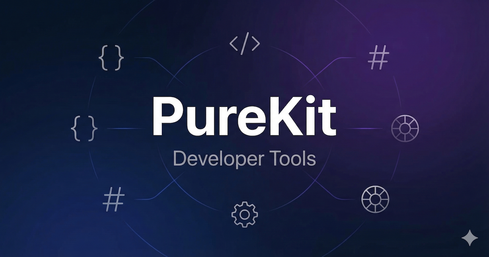

<p align="center">
  
</p>

<h1 align="center">PureKit</h1>

<p align="center">
  <strong>Free developer tools that run in your browser.</strong><br>
  No uploads. No tracking. No signup. Your data never leaves your device.
</p>

<p align="center">
  <a href="https://www.purekit.dev">Website</a> •
  <a href="#tools">Tools</a> •
  <a href="#getting-started">Getting Started</a> •
  <a href="#contributing">Contributing</a> •
  <a href="#license">License</a>
</p>

---

## Why PureKit?

Most "free" online tools upload your files to their servers, gate features behind paywalls, or track everything you do.

PureKit is different: **every tool runs 100% client-side** using browser APIs. Your JSON, images, JWT tokens — none of it ever leaves your browser tab. There's no backend to leak your data because there is no backend.

## Tools

### Developer Tools
| Tool | Description |
|------|-------------|
| [JWT Decoder](https://purekit.dev/en/jwt-decoder) | Decode and inspect JWT tokens |
| [JSON Diff](https://purekit.dev/en/json-diff) | Compare JSON objects side by side |
| [UUID Generator](https://purekit.dev/en/uuid-generator) | Generate UUIDs (v1, v4, v7) |
| [Gzip Compress/Decompress](https://purekit.dev/en/gzip-compress-decompress) | Compress and decompress with gzip |
| [HTML Viewer](https://purekit.dev/en/html-viewer) | Live HTML preview and rendering |

### PHP Tools
| Tool | Description |
|------|-------------|
| [PHP Version Checker](https://purekit.dev/en/php-version-checker) | Check a website's PHP version, PHP support status, and the minimum PHP version your code needs |
| [PHP2Shell Checker](https://purekit.dev/en/php2shell-checker) | Check whether a website or PHP version is affected by PHP2Shell (CVE-2026-109618/109619) |

### Image Tools
| Tool | Description |
|------|-------------|
| [Gemini Watermark Remover](https://purekit.dev/en/gemini-watermark-remover) | Remove watermarks from Gemini AI images |

## Tech Stack

- **Framework**: [Next.js](https://nextjs.org/) (Static Export)
- **UI**: [React](https://react.dev/) + [Tailwind CSS](https://tailwindcss.com/) + [shadcn/ui](https://ui.shadcn.com/)
- **Image Processing**: Canvas API + Web Workers
- **Hashing**: Web Crypto API
- **Deployment**: [Cloudflare Pages](https://pages.cloudflare.com/) (static, plus two Pages Functions: `functions/api/php-version.ts` for website PHP checks, and `functions/rks6/[[path]].ts`, which hands analytics requests to a proxy Worker through a service binding)

## Getting Started

### Prerequisites

- Node.js 18+
- npm

### Development

```bash
# Clone the repo
git clone https://github.com/WebCareerz/purekit_dev.git
cd purekit_dev

# Install dependencies
npm install

# Start dev server
npm run dev
```

Open [http://localhost:3000](http://localhost:3000) to see the site.

### Build

```bash
npm run build
```

The static site is generated in the `out/` directory, ready for deployment to any static hosting provider.

## Project Structure

```
purekit.dev/
├── app/
│   └── [lang]/           # Tool pages (one folder per tool)
│       ├── jwt-decoder/
│       ├── php-version-checker/
│       └── ...
├── components/
│   ├── tools/            # Tool-specific components
│   └── ui/               # Shared UI components (shadcn/ui)
├── i18n/                 # Internationalization strings
├── lib/                  # Shared utilities & tool registry
├── public/               # Static assets
└── scripts/              # SEO & indexing scripts
```

## Contributing

Contributions are welcome! Here's how you can help:

1. **Add a new tool** — Check [issues](https://github.com/WebCareerz/purekit_dev/issues) for requested tools
2. **Fix bugs** — Found something broken? PRs welcome
3. **Improve existing tools** — Better UX, performance, edge cases
4. **Translations** — Help translate tools to more languages

### Adding a New Tool

1. Create a new folder in `app/[lang]/your-tool-slug/`
2. Add the tool component in `components/tools/YourTool.tsx`
3. Register the tool in `lib/tools.ts`
4. Add i18n strings in `i18n/en.json`
5. Add the tool icon in `components/tools/ToolGrid.tsx`
6. Run `npm run build` to verify

### Guidelines

- **All processing must be client-side** — no server calls with user data
- **No cookies, no personal tracking** — only aggregate, cookieless analytics (Cloudflare Web Analytics and self-hosted Plausible)
- **Use established libraries** — don't reinvent parsers (Prettier > custom formatter)
- **Test on Chrome, Firefox, Safari** — cross-browser compatibility matters

## Acknowledgments

- [gemini-watermark-remover](https://github.com/GargantuaX/gemini-watermark-remover) by GargantuaX — Reverse alpha blending algorithm for Gemini watermark removal (MIT)

## License

[MIT](LICENSE) — Use it however you want.

## Links

- 🌐 [purekit.dev](https://www.purekit.dev)
- 🐦 [Twitter](https://x.com/xia_zai_7)
- 📧 support@purekit.dev
